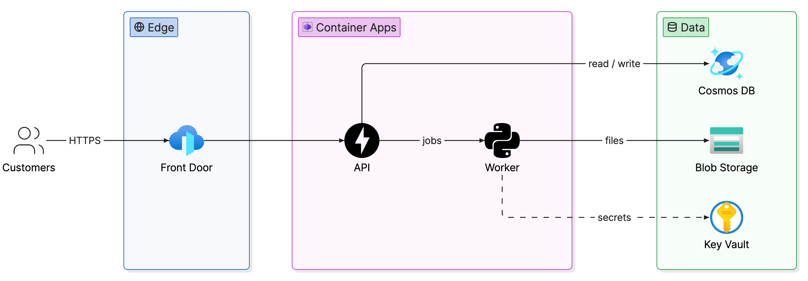
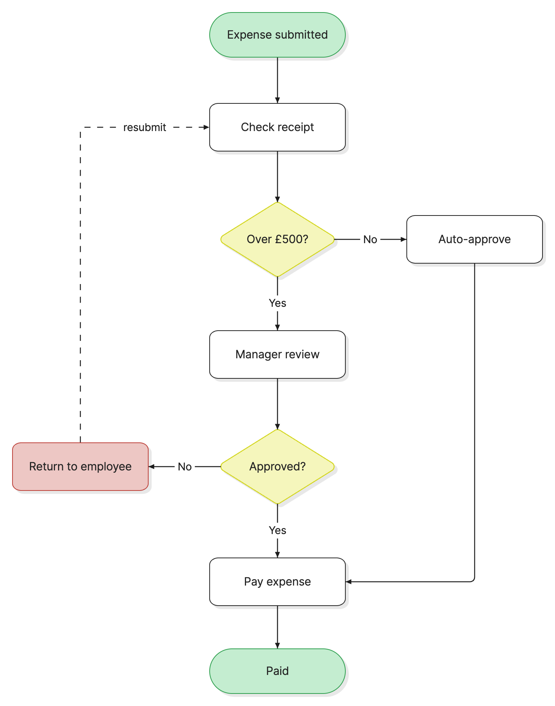
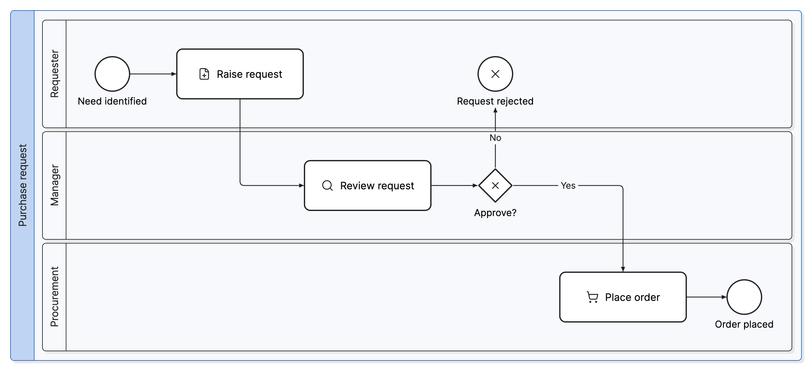
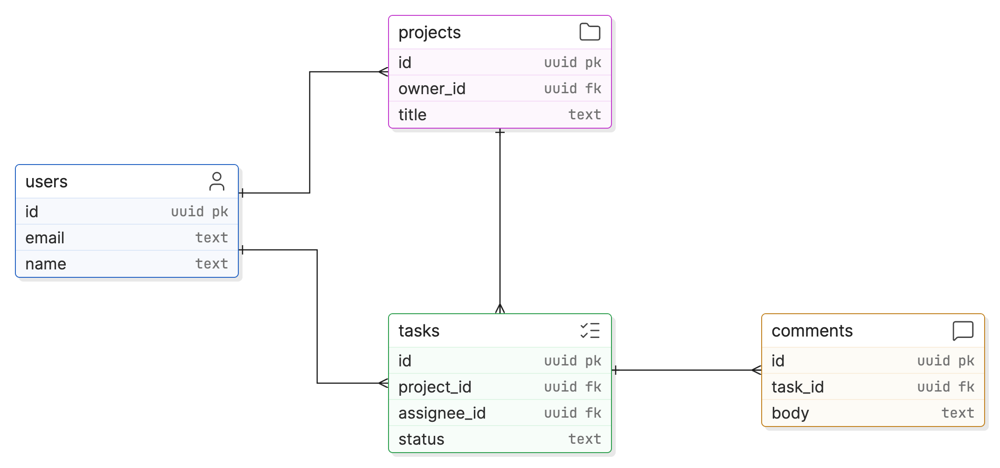

# eraser-diagrams

Ask Claude for a diagram and get a PNG back, drawn by
[Eraser's open-source diagram engine](https://github.com/eraserlabs/eraser-diagrams) on your own
machine. No Eraser account, no API key, nothing uploaded.

| Architecture | Flowchart |
| --- | --- |
|  |  |
| **Swimlane (BPMN)** | **Entity-relationship** |
|  |  |

## Use it

Just ask, in any project:

> Draw the architecture of this service — what calls what, and where the data lives.

> Turn the approval process in docs/process.md into a swimlane diagram.

> Make an ERD of the tables in src/db/models.py.

Or invoke it directly: `/eraser-diagrams:diagram <what to draw>`.

Claude writes `<name>.diagram.json`, renders `<name>.png` beside it, checks the layout, looks at
the image and fixes what is wrong, then hands you both files. To change a diagram later, ask for the
change; Claude edits the JSON and re-renders. Commit the JSON and the PNG together — the JSON is the
source, the PNG is derived.

Ask for **HTML** when you want a file that stays crisp at any zoom: it is self-contained (fonts
embedded) and opens in any browser.

## What you need

- **Node.js 22.12 or newer** — `node --version`.
- **Google Chrome, Chromium or Microsoft Edge** installed. The engine renders in a headless browser.
  It finds the usual install locations; otherwise set `CHROMIUM_PATH` to the executable.
- **Network access** to npm (first run only) and to Eraser's public icon catalog (every render).

The first render installs the engine — `@eraserlabs/diagrams-cli`, pinned to one version — into
`~/.cache/eraser-diagrams-skill/<version>/`. That takes a few seconds and happens once per version.

## Why the output is good, not just valid

The engine renders whatever coordinates it is given; it does not lay diagrams out. So the skill
gives Claude a layout method with measured sizes and spacing
([references/layout.md](skills/diagram/references/layout.md)), and after every render a check
loads the rendered page and measures what was actually painted. It reports:

| Finding | Meaning |
| --- | --- |
| `overlap` | Two nodes (captions included) overlap, or a node sits on a group it is not in. |
| `outside-container` | Something spills out of its group — usually an icon caption. Gives the size the group needs. |
| `label-on-node`, `label-crowded`, `short-line` | A connection label sits on, or is jammed against, a node. |
| `line-through-text`, `line-through-label` | A line is drawn across a caption or another line's label. |
| `lines-overlap` | Two connections run along the same stretch and read as one. |
| `too-small` | A shape was left to size itself and is cramped. |

Claude fixes these, then reads the PNG itself for what no check catches: crossings, reading order,
clutter, wrong icons.

## Run the tool yourself

The skill's helper works without Claude too:

```bash
H=$(ls -d ~/.claude/plugins/cache/appvision/eraser-diagrams/*/skills/diagram/scripts/eraser.mjs | tail -1)
node $H render my.diagram.json            # → my.png and a JSON report
node $H render my.diagram.json --html     # → also my.html
node $H icons "key vault" postgres        # search icon names
node $H doctor                            # check Node, engine and browser
```

From a checkout of this repository, `H=plugins/eraser-diagrams/skills/diagram/scripts/eraser.mjs`.
The diagram format is documented in [references/format.md](skills/diagram/references/format.md).

## Permissions

The skill pre-approves exactly one thing: its own helper (`node …/scripts/eraser.mjs …`), for the
turn that invokes it. Because it grants itself that permission, Claude Code asks you to allow the
skill when it starts. Allow it, and the icon searches and renders that follow run without further
prompts. On later turns, while you iterate on a diagram, Claude may ask again; approve it, or add
the allow rule `Skill(eraser-diagrams:diagram)` to your settings to stop being asked.

In headless runs (`claude -p`, CI), nobody can answer that prompt, so pass
`--allowedTools "Skill(eraser-diagrams:diagram)"`.

## Troubleshooting

| Symptom | Fix |
| --- | --- |
| `Node.js 22.12 or newer is required` | Upgrade Node (`brew install node`, `nvm install 22`, or nodejs.org). |
| `No Chrome, Chromium or Edge found` | Install Chrome, or `export CHROMIUM_PATH=/path/to/chrome`. |
| `npm install failed` | Behind a proxy or private registry? Check `npm view @eraserlabs/diagrams-cli version` works. |
| An icon shows as ✕ | Unknown icon name; Claude should search with `icons`. Tell it which one. |
| Anything else | `node …/eraser.mjs doctor` and include its output when you ask for help. |

## Maintaining

- **Engine version** is `ENGINE_VERSION` at the top of
  [scripts/eraser.mjs](skills/diagram/scripts/eraser.mjs). The engine is 0.x and minor versions may
  break; after bumping it, re-render the four examples, check they come out clean and look right,
  and re-check the measured sizes in `layout.md`.
- **Icon list** — [references/icons.txt](skills/diagram/references/icons.txt) is a snapshot of the
  hosted catalog. Refresh it with `node skills/diagram/scripts/eraser.mjs icons --refresh`.
- **Release** by bumping `version` in [.claude-plugin/plugin.json](.claude-plugin/plugin.json).

The rendering engine is © Eraser Labs, MIT licensed, and installed from npm at first use. It is not
bundled here.
